# Hearthdeep

A cozy co-op farming and cave-adventure game for 1–6 players, made in Godot 4.

You share a homestead at the edge of a valley. Fields to tend, a small town that
grows as you help it, and under the hill a cave system that goes deeper than
anyone remembers. Nothing tells you who should farm, fish or fight. Whoever ends
up doing what just does it, and the town notices.

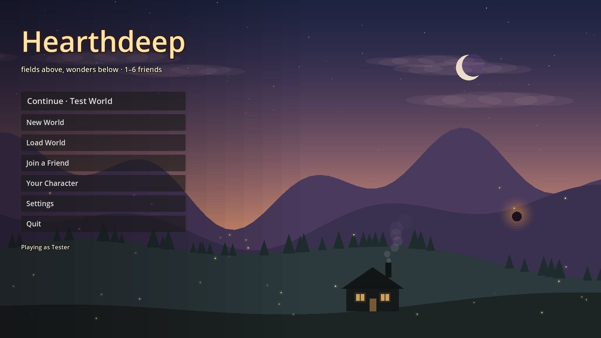

| | |
|---|---|
| 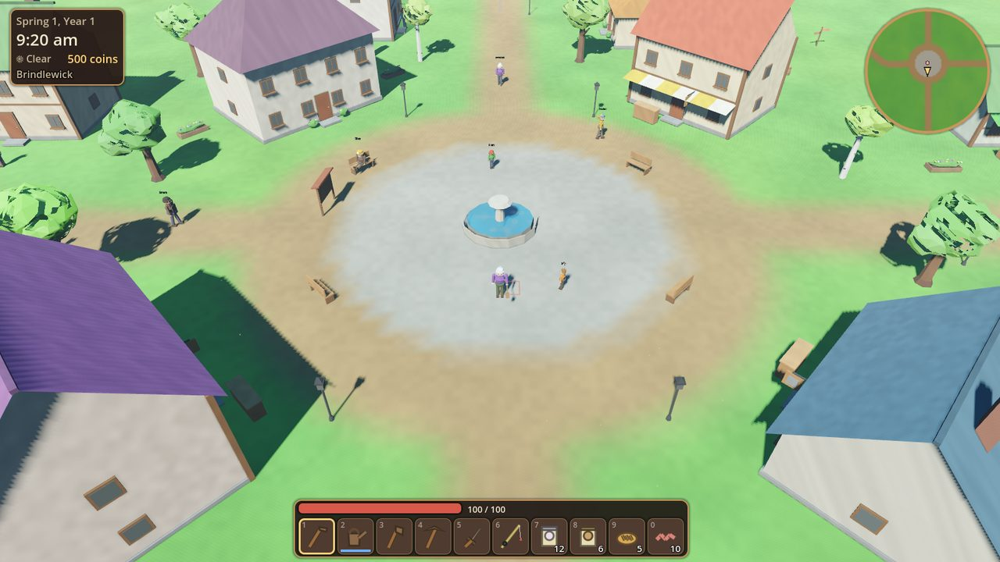 | 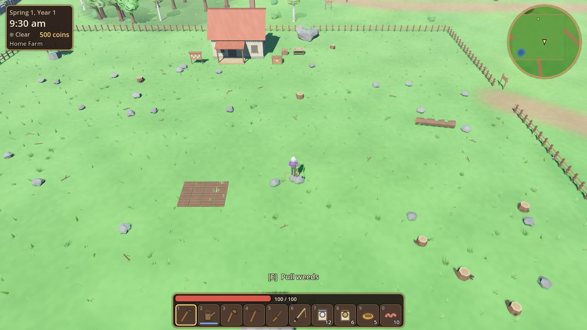 |
| 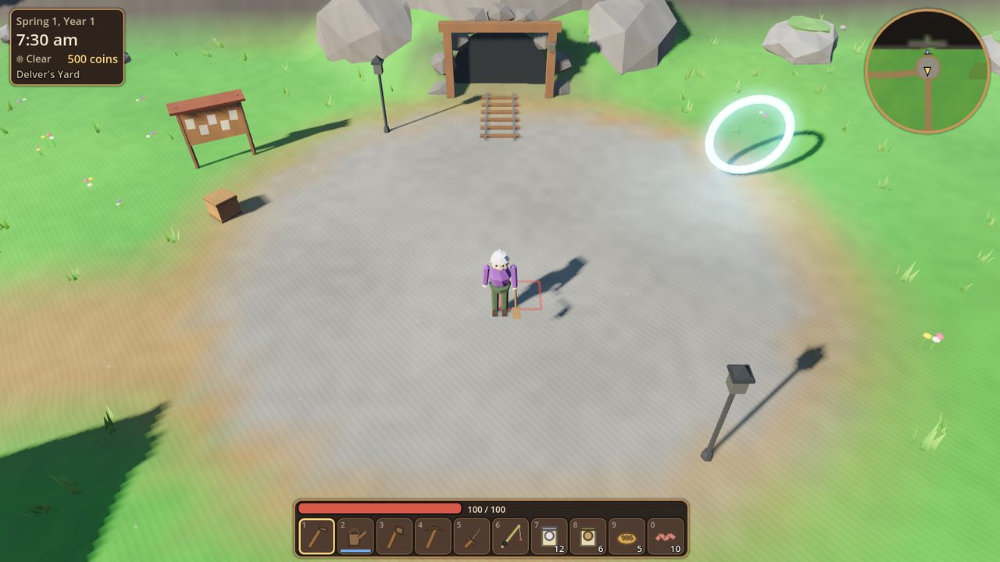 | 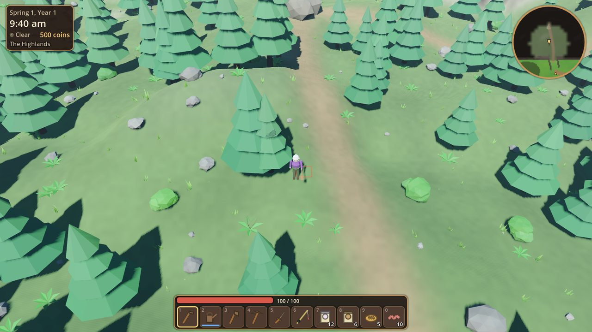 |
| 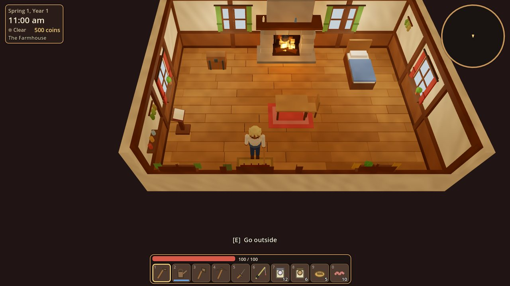 | 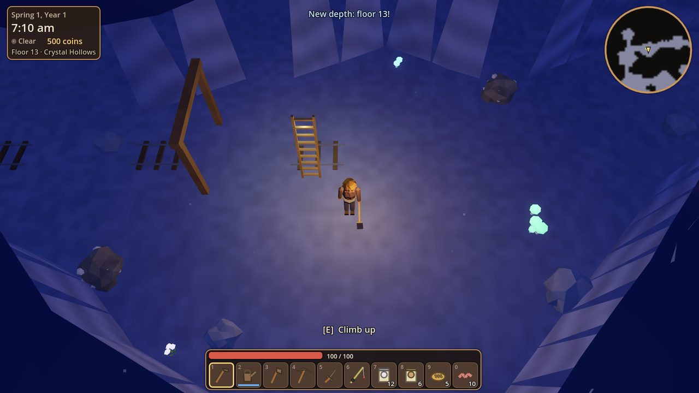 |
| 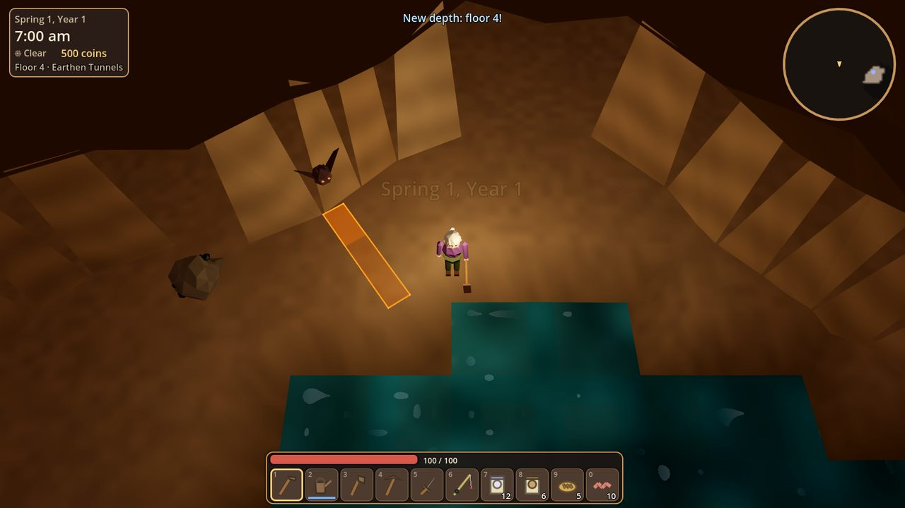 | 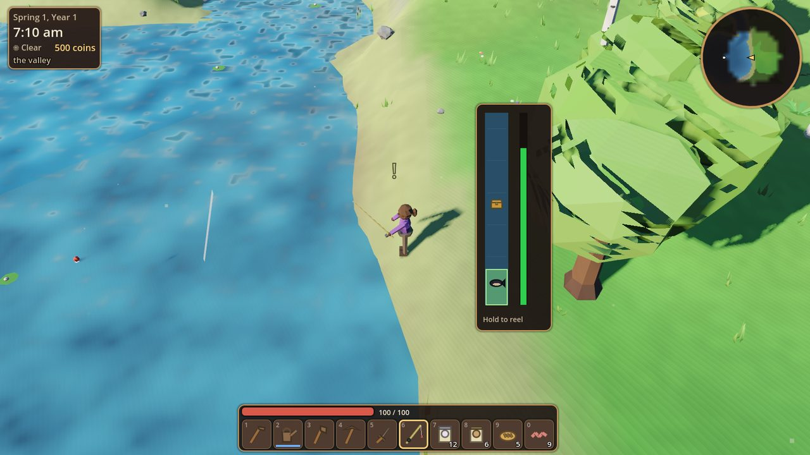 |
| 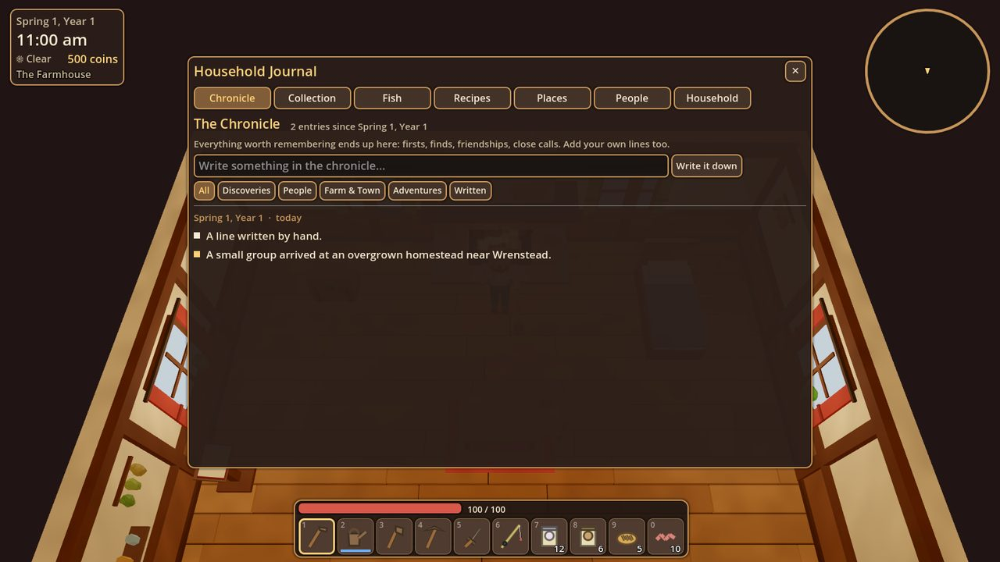 | 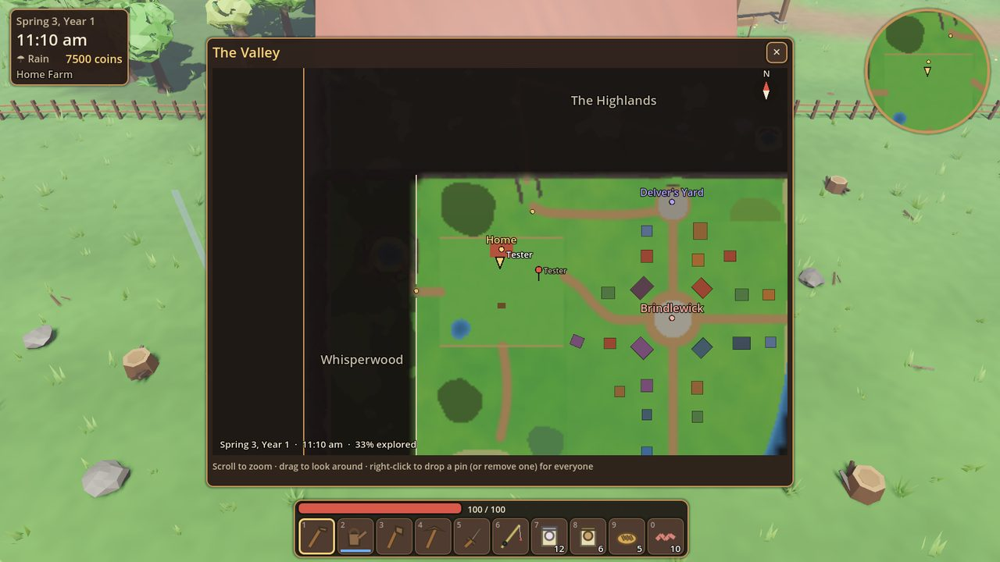 |

## Running it

1. Install **Godot 4.4 or newer** (standard build; no .NET needed). It's tested on 4.4 and 4.7.
2. Open `project.godot` in this folder and press **F5**, or run it directly:
   `godot --path "documents/godot games/Hearthdeep"`

Nothing needs importing. Every model, texture, icon, sound and piece of music is
generated by code when the game starts.

### Playing together

* **Host:** on the title screen choose *New World* or *Load World* and switch
  **Open to friends** on. The default port is **24565** (UDP). Forward it on your
  router if friends are joining over the internet.
* **Join:** choose *Join a Friend* and enter the host's address and port.
* Up to 6 players. The host's world is the save. Each guest keeps their own
  pack, skills and position in that world and gets them back next time they join.

## Controls

| Action | Keyboard / mouse | Gamepad |
|---|---|---|
| Move | WASD / arrows (Shift to walk) | Left stick |
| Use held item: tool, weapon, cast, eat, place | Left click | X |
| Interact: talk, open, harvest, pick up | E / F / right click | A |
| Dodge roll | Space | B |
| Hotbar | 1–0, mouse wheel | |
| Pack | Tab / I | Y |
| Map · Journal · Field crafting | M · J · C | Back |
| Drop · Rotate placement | G · T | |
| Turn camera · Zoom | Q / R · + / − | Bumpers |
| Chat · Pause | Enter · Esc | Start |

## What's in it

**The homestead.** Till, water and plant crops (27 kinds) that grow on a
per-season schedule. Sprinklers, fruit trees, a chicken coop, bee houses and
scarecrows. Overnight the shipping bin sells what you put in it, and the money
goes into one shared purse. The carpenter can renovate the farmhouse twice. The
interior grows with it, and anything you place inside stays where you put it. The
hearth cooks proper meals.

**The valley.** Hand-designed and the same in every world, like a Stardew
Valley map. Brindlewick's plaza sits in the middle with the Town Hall, General
Store, Tavern and Smithy around its fountain. Your farm is just west of town. The
cave mouth is a short walk up the north street, cut into the cliffs at Delver's
Yard. Willow Falls feeds a river that runs down the east side and along the south
into Heron Lake, with a pier for fishing. Weather and seasons change the light,
the foliage, the snow and what grows, bites and blooms.

**The wilds.** Beyond the valley's borders, which are the cliffs, the river and a
dry-stone wall, the land is different in every world: the Highlands up a trail
through the cliffs, Whisperwood past the west gate, Fenmarsh over the south
bridge and Eastmeadow over the east bridge. Out there you find camps, ruins,
standing stones, a watchtower, mushroom rings, copper outcrops, a hidden pool, a
hot spring and more. Each landmark is named, and the first person to reach it
gets their name in the chronicle. Forage and dig spots change daily.

**The town.** The same folks in every world: nineteen residents in ten
households, from Mayor Rosalind Thatcher and her family to Bram the blacksmith,
Juniper at the apothecary and Hollis down at the bait shop. Each has a job,
family, temperament, interests, a birthday, things they love and things they
can't stand, and one wish. Shops keep hours. Residents walk the streets on their
daily routines, post requests on the board and react to what the household has
done lately. They also slowly notice who has become "the one who fishes".
Friendship milestones bring gifts and recipes. Eleven community projects
(mending the old bridge, lamps, a market, cottages for newcomers, a pier, a lodge,
a curio hall and more) change the town physically and bring in new neighbors.

**The caves.** Every floor is generated: winding tunnels, big caverns, old mine
passages with rails, underground lakes, chasms with narrow bridges, lava, hidden
chambers behind cracked walls, and six biomes as you go down (Earthen Tunnels,
Mossy Grotto, Crystal Hollows, Fungal Depths, Ember Rift, Ancient Halls). Each floor
has ore, gems, rare plants, treasure, fishing spots, notes left by the Lantern
Company who went down long ago, and keepsakes the townsfolk lost. A floor's map
fills in as anyone in the household explores it.

Getting in and out works like Fate. The cave mouth always offers floor 1 or
straight down to the deepest floor anyone has reached. A Homeward Rope takes you
back up to Delver's Yard and leaves a shimmering portal that drops you back at
the exact spot you left. You start with three ropes; they're cheap at the
General Store, or crafted from fiber and sap. Waystones let you jump to the
depths you've attuned.

**Combat.** Readable on purpose. Eight creature types, each with its own
behavior: bats circle and dart in, burrowers tunnel under you and burst up,
shellbacks charge and stun themselves if you sidestep them into a wall,
mosslings hop at you, spore spitters lob shots from a distance, crystal golems
slam and throw shards, ember salamanders charge and leave burning trails, and
ancient sentinels leap in and sweep. Every attack is telegraphed on the ground
before it lands. Weapons differ in feel: swords sweep, spears reach, hammers slam, bows
charge. Dodge rolls give invulnerability frames. Loot comes with a few
plain-language traits ("Swift: +12% movement speed", "Lucky: treasure turns up
more often", "Ember: hits set creatures ablaze"...).

**Fishing, brewing, cooking, smelting.** 29 fish that depend on water, season,
time of day and weather. Each one fights differently in the reeling minigame,
and some carry treasure. Brewing works on essences: every ingredient carries a
few, the strongest decides the brew and the second can twist it. You discover
recipes by experimenting, and the first person to brew something gets the credit.
There are 21 dishes, plus drinks, bars from ore, and 38 crafting plans that unlock
as you find new things.

**No stamina, no forced sleep, gentle failure.** When everyone is in bed, the
night rushes by. If anyone stays up, the next day simply starts. If you go down,
a friend can pick you up. Otherwise you wake up at home and may have dropped a
few things on the way, depending on the world setting. Nothing is ever wiped.

**The chronicle.** The game records the household's history: firsts, finds,
new depths, friendships, finished projects, rescues, record fish. You can add
your own lines too. Read it on the board outside or in the journal, which also
holds the collection (every item, found or not), the fish log, recipes, places,
lore notes, everyone in town and each player's skills and stats.

## How it's built

* **One code path for single player and multiplayer.** Gameplay changes go
  through `Net.request(action)`. The server checks the action in `ServerLogic`
  (`scripts/core/server.gd`, plus `TownLogic` and `QuestLogic`) and broadcasts a
  change, and every peer applies it in `Game.apply_change()`. Single player runs
  the same path over an `OfflineMultiplayerPeer`. Movement and your own pack are
  client-side for responsiveness.
* **Zones side by side.** The overworld, the farmhouse and each cave floor are
  separate `Zone` nodes placed at different offsets in one 3D world, so the host
  can simulate several areas at once while friends split up.
* **A designed valley, generated wilds.** The valley is laid out by hand in
  `scripts/gen/valley_layout.gd`: farm, streets, buildings, river, lake, borders,
  gates, groves, lamps and benches. The townsfolk are written in
  `scripts/gen/town_cast.gd`. `OverworldGen` builds that valley the same way every
  time, then generates the wilds beyond the borders and the caves from the world
  seed. Clients rebuild everything locally instead of downloading it, and
  townsfolk schedules are pure functions of game time.
* **Procedural assets.** `MeshBuilder` builds flat-shaded, vertex-colored meshes.
  The look comes from a few custom shaders: wind and snow on foliage, a cutaway
  around the player, roofs and walls that hide when they block the view, water,
  lava and telegraphs. `IconPainter` draws item icons, and `Sfx` synthesizes sound
  effects, ambience and music on a background thread.

```
scripts/
  core/      autoloads: Game (state, clock, changes), Net, ServerLogic, Zones, Items, Meshes, Sfx
  gen/       ValleyLayout (the hand-made valley), TownCast (the townsfolk), OverworldGen,
             TownGen, CaveGen, Dialogue, Lore
  world/     Overworld, HomeZone, CaveFloor, FarmLayer, TownBuilder, EnvController
  entities/  Player, NPC, Enemy, Animal, ResourceNode, PlacedObj, Feature, Pickup, Projectile, CameraRig
  systems/   Inventory, Loot, Fishing, TownLogic, QuestLogic
  build/     MeshBuilder, Props, CaveProps, ItemModels, Doll (characters), Fx
  ui/        HUD, Minimap, UIRoot + windows (pack, chests, crafting, kettle, cooking, furnace,
             shops, gifts, board, smithy, renovation, journal, map), MainMenu, Tips
  tests/     AutoTest
```

## Tests

The project has command-line tests that start real worlds and play them. Most
run headless:

```
godot --headless --path . -- --autotest=play     # gathering, farming, chests, crafting, brewing, travel
godot --headless --path . -- --autotest=town     # dialogue, shops, gifts, projects built overnight
godot --headless --path . -- --autotest=cave:1:5:13:28   # floors build, exits reachable, combat
godot --headless --path . -- --autotest=fish     # cast, bite, minigame, fish log
godot --headless --path . -- --autotest=home     # interior, renovations, journal, map, cave fog
godot --headless --path . -- --autotest=menu     # title screen and a save -> quit -> load round trip
godot --headless --path . -- --autotest=delve    # Homeward Rope, return portal, straight to the deepest floor
godot --headless --path . -- --autotest=towncheck  # walking routes, decor and cast data are sound
```

Multiplayer runs two processes at once:

```
godot --headless --path . -- --autotest=mphost:24601 &
godot --headless --path . -- --autotest=mpclient:24601
```

Each test prints `PASS`/`FAIL` lines and ends with `DONE fails=N`. Run the same
tests with a window (or under `xvfb-run`) and they also save screenshots to
`tests_out/`. `--autotest=valley` photographs spots around the valley,
`--autotest=mapdump` saves a top-down layout image, and
`--autotest=gallery:props` (or `cave`, `place`, `crops`, `items`) renders model
sheets.

## Known limits

* A gamepad covers walking, fighting, gathering, fishing and the hotbar. With a
  pad you aim the way you're facing. Windows such as the pack, shops and the
  journal still need the mouse.
* Online play is plain ENet with no NAT punch-through. The host may need to
  forward UDP port 24565.
* Saves are text files in the user data folder (`user://worlds`). They are
  readable, but not meant to be edited by hand while the game is running.
